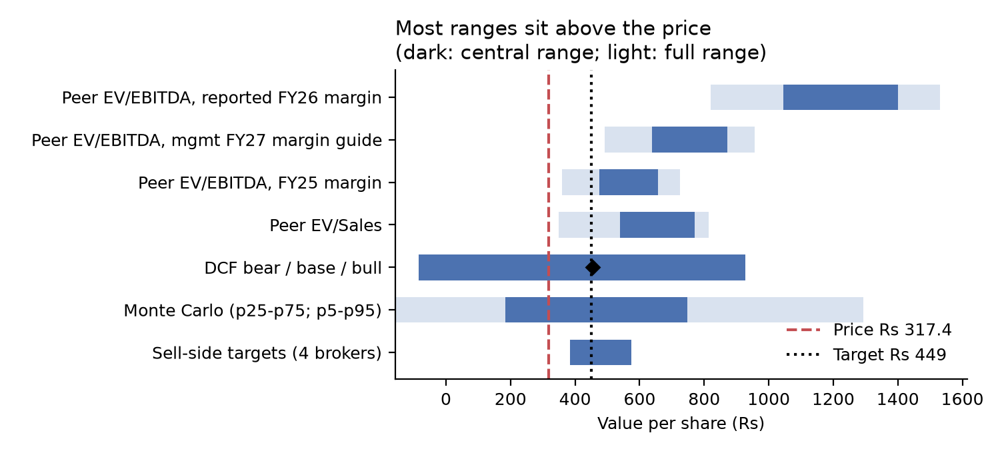
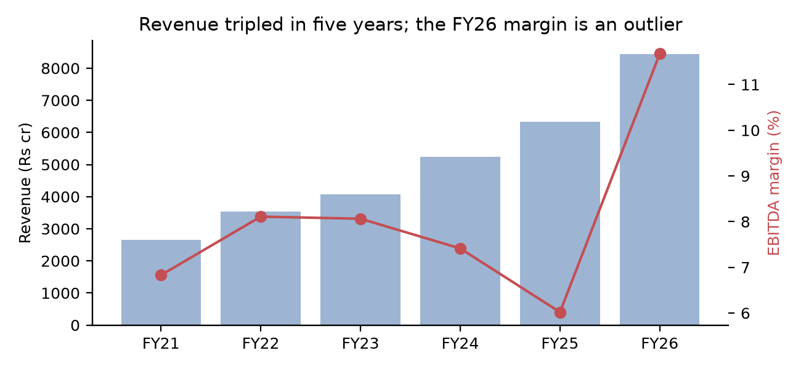
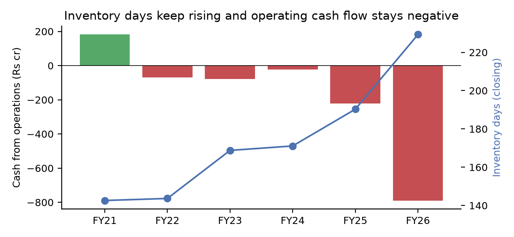
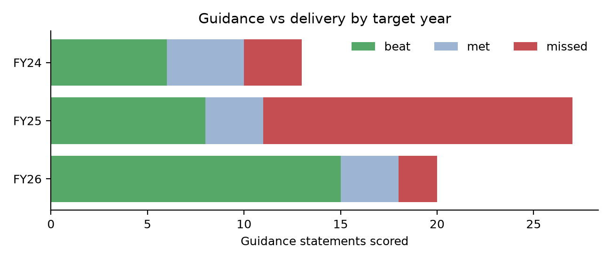
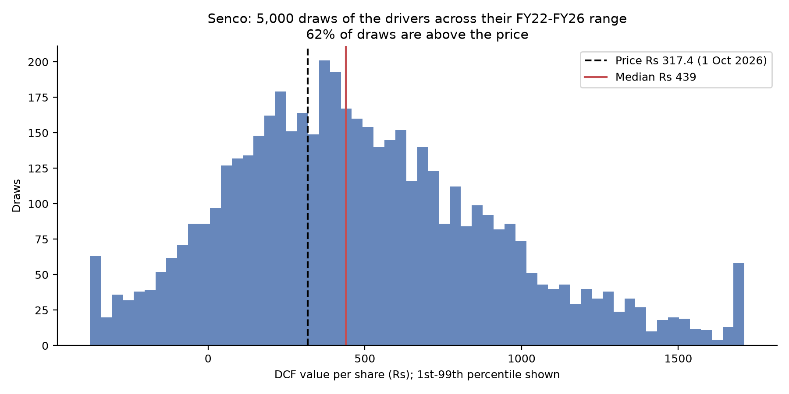

<!-- Report text. Every model number is a {placeholder} filled by `python -m senco.report`. A number typed by hand must sit on a line with a citation [^n]; `python -m senco.report check` enforces this. Write each paragraph on one line so its citation stays on the same line. -->

# Senco Gold Ltd (NSE: SENCO): Initiating coverage

> **Rating: {rating}. Target price: Rs {tp}, {tp_up} above the price of Rs {price} on {price_date}.**
>
> Market value Rs {mktcap} cr; enterprise value Rs {ev_mkt} cr; {shares_mn} mn shares. Senco trades at {sen_ev_ebitda}x FY26 EV/EBITDA and {sen_pe}x FY26 P/E, against peer medians of {peer_med_eve}x and {peer_med_pe}x.
>
> The target method is set out under Valuation. All figures are Rs crore, consolidated, March year-end, unless marked.

## Investment summary

**The price sits below management's own plan.** On management's growth path and a {wacc} WACC, the price of Rs {price} is justified by an EBITDA margin of {imp_margin}, inside management's sustainable guide of 7.5% to 7.8% (Q1FY27 call, p.5-6).[^q1fy27] Holding margins at plan, the price needs same-store growth of {imp_sssg} a year against {mg_sssg_FY28} guided, or a WACC of {imp_wacc}. The market is not pricing a collapse; it doubts the plan and discounts the cash burn. Listed peers trade at {peer_min_eve}x to {peer_max_eve}x EV/EBITDA; Senco trades at {sen_ev_ebitda}x.

**The discount is about cash, and the cash problem is real.** Operating cash flow was negative in every year from FY22 to FY26, a total of {cfo_sum_22_26}. Closing inventory days rose from {inv_days_FY21} in FY21 to {inv_days_FY26} in FY26. In our base case, built mostly from Senco's own FY22-FY26 medians, free cash flow is {base_fcf} over FY27-FY31 and debt/equity reaches {base_de31}x. Growth is funded by lenders, suppliers and customers.

**Management delivers on revenue, less so on store openings.** Of {del_n} guidance statements we could score against a reported number, {del_hit} were met or beaten ({del_rate}). Revenue growth guidance was met {del_m_revenue_growth_hit} of {del_m_revenue_growth_n} times and EBITDA margin guidance {del_m_ebitda_margin_hit} of {del_m_ebitda_margin_n}. Showroom additions were met {del_m_showroom_additions_hit} of {del_m_showroom_additions_n} times, and profit growth guidance {del_m_pat_growth_hit} of {del_m_pat_growth_n}.

**Our view.** We value Senco on the lowest peer multiples, applied to FY26 revenue at management's sustainable margin guide of {mg_margin_FY27}. That gives Rs {tp}, inside the sell-side range of Rs {broker_lo} to Rs {broker_hi}. We do not set the target on the DCF: free cash flow is negative through FY31 in all three cases, so almost all the value sits in the terminal year and small changes move it a lot.

## The company

Senco Gold sells gold and diamond jewellery through company-owned and franchise showrooms. Management says 65% to 70% of the business comes from Eastern India and West Bengal, and new stores will be mostly franchise, focused on East and North India (Q1FY27 call, p.2-3).[^q1fy27] Its longer-term target is revenue above Rs 20,000 cr and 300+ stores in four to five years (Q1FY27 call, p.16).[^q1fy27]

| | FY21 | FY22 | FY23 | FY24 | FY25 | FY26 |
|---|---|---|---|---|---|---|
| Revenue | {sales_FY21} | {sales_FY22} | {sales_FY23} | {sales_FY24} | {sales_FY25} | {sales_FY26} |
| Revenue growth | | {growth_FY22} | {growth_FY23} | {growth_FY24} | {growth_FY25} | {growth_FY26} |
| EBITDA margin | {ebitda_m_FY21} | {ebitda_m_FY22} | {ebitda_m_FY23} | {ebitda_m_FY24} | {ebitda_m_FY25} | {ebitda_m_FY26} |
| Net margin | {net_margin_FY21} | {net_margin_FY22} | {net_margin_FY23} | {net_margin_FY24} | {net_margin_FY25} | {net_margin_FY26} |
| ROE | {roe_FY21} | {roe_FY22} | {roe_FY23} | {roe_FY24} | {roe_FY25} | {roe_FY26} |
| Inventory days (closing) | {inv_days_FY21} | {inv_days_FY22} | {inv_days_FY23} | {inv_days_FY24} | {inv_days_FY25} | {inv_days_FY26} |
| Cash from operations | {cfo_FY21} | {cfo_FY22} | {cfo_FY23} | {cfo_FY24} | {cfo_FY25} | {cfo_FY26} |

Source: Screener.in consolidated export; ratios from `senco/financials.py`.[^screener]

Revenue grew {sales_cagr_21_26} a year from FY21 to FY26. The FY26 EBITDA margin of {ebitda_m_FY26} is an outlier. Gold prices rose sharply that year and Senco holds inventory for months, so part of the margin is a gain on stock. Management itself guides to a sustainable margin of 7.5% to 7.8% (Q1FY27 call, p.5-6).[^q1fy27] It said the Q1FY26 margin included 1.5 to 2 points of inventory gains (Q1FY27 call, p.6).[^q1fy27]

At FY26, borrowings were {borrowings_FY26} and cash {cash_FY26}, so net debt was {net_debt_FY26}, or {nde_FY26}x equity. Screener's borrowings include gold metal loans and lease liabilities (FY26 annual report, p.278-279 and p.325).[^ar26] We treat both as debt.

## Industry

**A large market moving to organised players.** Indian retail jewellery was worth about Rs 8.3 trillion in FY25, after growing 16.7% a year from FY19; BOB Capital Markets forecasts 10% to 12% a year to FY29.[^bobsector] It puts the organised share at 30% to 35% in FY19, 37% to 42% in FY25 and 44% to 49% by FY29.[^bobsector] Senco's own presentation shows a similar path, from 40% in 2025 to 50% by 2029.[^senco_ip]

**Rules that favour organised jewellers.** BIS hallmarking became mandatory on 23 Jun 2021 and now covers 380 districts after a sixth phase in March 2026.[^hallmark] PAN has been required on purchases above Rs 2 lakh since January 2016, and GST applies since July 2017.[^bobsector] Each step raises the cost of operating outside the formal system.

**Gold price and duty.** Senco's reported gold price rose from Rs 9,020 a gram at 31 Mar 2025 to Rs 14,692 at 31 Mar 2026, up 63%; the FY26 average was Rs 12,111 against Rs 7,653 in FY25.[^senco_pr] Import duty was cut from 15% to 6% on 24 Jul 2024 and raised back to 15% on 13 May 2026.[^duty_cut][^duty_rise] Duty changes move the value of jewellers' stock and the gap between official and grey-market gold.

**Volumes down, value up.** Indian jewellery demand fell 24% to 430.5 tonnes in 2025 while value reached a record USD 49 bn, according to the World Gold Council.[^wgc2025] In April-June 2026 jewellery demand was 75.1 tonnes against 88.8 tonnes a year earlier, while value rose 50%.[^wgc_q2] Customers are buying lighter pieces and lower carats, and Senco is widening its 9-carat and 14-carat range (Q1FY27 call, p.3).[^q1fy27] Revenue growth in this market is mostly price, not grams.

| Chain | Stores | Date |
|---|---|---|
| Senco (120 own, 89 franchise) | 209 | 30 Jun 2026 [^senco_ip] |
| Kalyan Jewellers (India) | 354 | Q1FY27 [^kalyan] |
| P N Gadgil Jewellers | 78 | 30 Jun 2026 [^png] |
| Thangamayil Jewellery | 66 | Q1FY27 [^thanga] |

**Senco's position.** Of its 209 showrooms, 109 are in West Bengal and 32 more in the rest of the East; North has 25, and franchise showrooms bring about a third of revenue.[^senco_ip] Its plan is to grow mostly through franchise stores in East and North India (Q1FY27 call, p.3).[^q1fy27] Titan (Tanishq and other brands) is the national leader, but we could not find a Tanishq-only store count, so it is left out of the table.[^titan]

## Guidance vs delivery

We read {del_rows} guidance statements from the 13 earnings calls between Q1FY24 and Q1FY27 and scored each against the reported result.[^calls] {del_not_due} are not yet due and {del_no_actual} have no reported number to check. Of the {del_n} that could be scored, {del_hit} were met or beaten ({del_rate}). Counting each metric and period once, using the latest guidance, the rate is {del_distinct_hit} of {del_distinct_n} ({del_distinct_rate}).

| Metric | Met or beaten | Scored |
|---|---|---|
| Revenue growth | {del_m_revenue_growth_hit} | {del_m_revenue_growth_n} |
| Same-store growth | {del_m_sssg_hit} | {del_m_sssg_n} |
| EBITDA margin | {del_m_ebitda_margin_hit} | {del_m_ebitda_margin_n} |
| Gross margin | {del_m_gross_margin_hit} | {del_m_gross_margin_n} |
| PAT margin | {del_m_pat_margin_hit} | {del_m_pat_margin_n} |
| PAT growth | {del_m_pat_growth_hit} | {del_m_pat_growth_n} |
| Showroom additions | {del_m_showroom_additions_hit} | {del_m_showroom_additions_n} |
| Diamond share | {del_m_diamond_share_hit} | {del_m_diamond_share_n} |
| Debt | {del_m_debt_hit} | {del_m_debt_n} |
| Other | {del_m_other_hit} | {del_m_other_n} |
| **All** | **{del_hit}** | **{del_n}** |

By target year: FY24 {del_FY24_hit} of {del_FY24_n}, FY25 {del_FY25_hit} of {del_FY25_n}, FY26 {del_FY26_hit} of {del_FY26_n}. FY25 was the weak year: margins fell to {ebitda_m_FY25}. In FY26 nearly everything was delivered, helped by the gold price.

What this means for the model: management's revenue guidance has been reliable, so we use it for the management case. Its margin guidance has also mostly been met, but in a rising gold market. Store-opening guidance is less reliable and does not drive value much in our model.

## Forecasts

### Management case

This case uses management's guidance where it exists: revenue growth of 20% to 25% for FY27 and 18% to 20% after, new stores adding 6 to 8 points, and a sustainable margin of 7.5% to 7.8% (guidance IDs G160, G123, G133 in `data/guidance.csv`).[^calls] Working capital follows management's inventory commentary.

| | FY27 | FY28 | FY31 |
|---|---|---|---|
| Revenue growth | {mg_growth_FY27} | {mg_growth_FY28} | {mg_growth_FY31} |
| of which same-store growth | {mg_sssg_FY27} | {mg_sssg_FY28} | {mg_sssg_FY31} |
| EBITDA margin | {mg_margin_FY27} | {mg_margin_FY28} | {mg_margin_FY31} |
| Inventory days | {mg_inv_FY27} | {mg_inv_FY28} | {mg_inv_FY31} |
| Revenue | {mg_rev_FY27} | {mg_rev_FY28} | {mg_rev_FY31} |
| Net profit | {mg_pat_FY27} | {mg_pat_FY28} | {mg_pat_FY31} |
| EPS (Rs) | {mg_eps_FY27} | {mg_eps_FY28} | {mg_eps_FY31} |
| ROE | {mg_roe_FY27} | {mg_roe_FY28} | {mg_roe_FY31} |
| Debt / equity (x) | {mg_de_FY27} | {mg_de_FY28} | {mg_de_FY31} |
| Free cash flow | {mg_fcf_FY27} | {mg_fcf_FY28} | {mg_fcf_FY31} |

On FY27 EPS of Rs {mg_eps_FY27}, the stock trades at {mg_pe_FY27}x. Free cash flow over FY27-FY31 adds up to {mg_fcf_sum}. That depends on inventory days falling from {inv_days_avg_FY26} in FY26 to {mg_inv_FY28} by FY28, as management plans: held at the FY26 level, the same total is {mg_fcf_sum_invflat}.

### Bear, base and bull

These cases come from Senco's own history, not from guidance. Each value driver takes the FY22-FY26 median in the base case, and the 25th and 75th percentiles in the worse and better direction for bear and bull. The one exception is other liabilities: the base case uses the FY26 level excluding one-off items, and the bull case the full reported FY26 level (see the working-capital section). Drivers that do not clearly help or hurt (tax rate, depreciation, capex, payout) sit at the median in all three. The rule is in `senco/cases.py`.[^method]

| | Bear | Base | Bull |
|---|---|---|---|
| Revenue growth | {bear_growth} | {base_growth} | {bull_growth} |
| EBITDA margin | {bear_margin} | {base_margin} | {bull_margin} |
| Inventory days | {bear_inv} | {base_inv} | {bull_inv} |
| Other liabilities (days of revenue) | {bear_oliab} | {base_oliab} | {bull_oliab} |
| EPS FY27 (Rs) | {bear_eps27} | {base_eps27} | {bull_eps27} |
| Net profit FY31 | {bear_pat31} | {base_pat31} | {bull_pat31} |
| Debt / equity FY31 (x) | {bear_de31} | {base_de31} | {bull_de31} |
| Free cash flow FY27-FY31 | {bear_fcf} | {base_fcf} | {bull_fcf} |
| DCF value (Rs/share) | {bear_dcf} | {base_dcf} | {bull_dcf} |
| Terminal value share of EV | {bear_tv} | {base_tv} | {bull_tv} |

Free cash flow is negative in all three cases, because each rupee of new sales needs months of inventory. The bear case burns the most: it has the slowest growth but the most inventory days and the least funding from customers and suppliers. A terminal value larger than the whole enterprise value means the explicit years destroy value and the terminal year has to make it back.

## The working-capital question

"Other liabilities" in Screener's balance sheet rose from {oliab_FY25} at FY25 to {oliab_FY26} at FY26, or from {oliab_days_FY25} to {oliab_days_FY26} days of revenue. Before FY26 the range was {oliab_days_min} to {oliab_days_max_pre26} days. This line funds inventory, so it matters a great deal. With everything else in the base case unchanged, the DCF value is Rs {base_dcf_oliabmed} at the FY22-FY26 median of {oliab_days_median} days and Rs {base_dcf_oliab80} at the reported FY26 level.

We rebuilt the line from the FY26 annual report.[^ar26] It is not gold metal loans, which have their own line and fell in FY26. The rise came from three places:

| Rs crore | FY25 | FY26 |
|---|---|---|
| Revenue received in advance | {li_adv_FY25} | {li_adv_FY26} |
| Scheme deposits from customers | {li_scheme_FY25} | {li_scheme_FY26} |
| Trade payables, incl. acceptances | {li_trade_FY25} | {li_trade_FY26} |
| of which acceptances | {li_accept_FY25} | {li_accept_FY26} |
| Current tax liabilities | {li_tax_FY25} | {li_tax_FY26} |
| Total "other liabilities" | {li_total_FY25} | {li_total_FY26} |

Customer advances and scheme deposits grow with the business and are likely to persist. The tax liability is a one-year item, and acceptances are deferred payments to suppliers that behave like short-term debt. Management gave no explanation for the advances, payables or tax figures in the annual report or the Q4FY26 call.[^ar26] Excluding tax and acceptances, FY26 other liabilities were {oliab_days_adj} days of revenue. Our base case uses this level, which gives Rs {base_dcf}. The bull case assumes the whole FY26 rise persists ({bull_oliab} days) and the bear case that it reverses to the FY22-FY26 25th percentile ({bear_oliab} days). The H1FY27 balance sheet will show which is closer.

## Valuation

### Discount rate

| Input | Value |
|---|---|
| Risk-free rate | {rf} |
| Beta | {beta} |
| Equity risk premium | {erp} |
| Cost of equity | {ke} |
| Cost of debt (FY26 interest / average borrowings) | {kd} |
| Debt weight (market values) | {debt_w} |
| WACC built from these inputs | {wacc_built} |
| **WACC used** | **{wacc}** |
| Terminal growth | {tg} |

The risk-free rate, beta and equity risk premium are Alpha Spread's, retrieved 8 Oct 2026.[^alphaspread] Built from them, the WACC is {wacc_built}. That is low for a small, cash-burning Indian retailer, so we use {wacc} instead. The CAPM build is shown as a cross-check only. After FY31 growth fades in a straight line to the terminal rate over {fade} years, with FY31 ratios held.

### DCF, management case

The management case gives Rs {dcf_mg} a share, {dcf_mg_up} above the price. Enterprise value is {dcf_mg_ev}, of which {dcf_mg_tv} is terminal value. The terminal value is {dcf_mg_tvx}x the final year's EBITDA, and net working capital ends at {dcf_mg_nwc} of revenue. Across WACC within one point of {wacc} and terminal growth within one point of {tg}, value ranges from Rs {grid_lo} to Rs {grid_hi}.[^method]

### Reverse DCF

What does Rs {price} assume? Changing one driver at a time on the management case:

| Driver (FY27-FY31, held flat) | Needed to justify the price | History FY22-FY26 |
|---|---|---|
| EBITDA margin | {imp_margin} | low {ebitda_m_FY25}, FY26 {ebitda_m_FY26} |
| Same-store growth | {imp_sssg} | management guides {mg_sssg_FY28} |
| Inventory days (average) | {imp_inv} | FY25 {inv_days_avg_FY25}, FY26 {inv_days_avg_FY26} |
| WACC | {imp_wacc} | used {wacc}; CAPM build {wacc_built} |

The most plausible single answer is a higher discount rate. The price needs {imp_wacc}, not far above the {wacc} we use.

### Peer multiples

| | EV/EBITDA | P/E | Inventory days | EBITDA margin |
|---|---|---|---|---|
| Kalyan Jewellers | {KALYANKJIL_eve}x | {KALYANKJIL_pe}x | {KALYANKJIL_inv} | {KALYANKJIL_margin} |
| Thangamayil Jewellery | {THANGAMAYL_eve}x | {THANGAMAYL_pe}x | {THANGAMAYL_inv} | {THANGAMAYL_margin} |
| P N Gadgil Jewellers | {PNGJL_eve}x | {PNGJL_pe}x | {PNGJL_inv} | {PNGJL_margin} |
| **Senco** | **{sen_ev_ebitda}x** | **{sen_pe}x** | **{sen_inv_closing}** | **{sen_margin}** |

FY26 figures at prices on {price_date}, from the jewellery-peer-comps project.[^comps] Senco's reported FY26 margin flatters its multiple. The table below restates Senco's FY26 EBITDA and profit at other margins and applies the peer median and minimum.

| Senco margin used | EV/EBITDA, median | EV/EBITDA, minimum | P/E, median | P/E, minimum |
|---|---|---|---|---|
| FY26 reported ({sen_margin}) | {cmp_rep_eve_med} | {cmp_rep_eve_min} | {cmp_rep_pe_med} | {cmp_rep_pe_min} |
| Management guide ({mg_margin_FY27}) | {cmp_guide_eve_med} | {cmp_guide_eve_min} | {cmp_guide_pe_med} | {cmp_guide_pe_min} |
| FY24 ({ebitda_m_FY24}) | {cmp_fy24_eve_med} | {cmp_fy24_eve_min} | {cmp_fy24_pe_med} | {cmp_fy24_pe_min} |
| FY25 ({ebitda_m_FY25}) | {cmp_fy25_eve_med} | {cmp_fy25_eve_min} | {cmp_fy25_pe_med} | {cmp_fy25_pe_min} |

Rs per share. The peer median EV/Sales of {peer_med_evs}x gives Rs {cmp_evs_med} on any margin. For the price to match the peer median EV/EBITDA, Senco's margin would have to be {mfp_eve_med}; for the peer minimum, {mfp_eve_min}.

### Monte Carlo

We drew {mc_n} combinations of the drivers, each from a triangular distribution over its FY22-FY26 minimum, median and maximum (for other liabilities the peak is the base case's {oliab_days_adj} days instead of the median), with WACC within one point of {wacc} and terminal growth within one point of {tg}.[^method] The median value is Rs {mc_med}; the middle half runs from Rs {mc_p25} to Rs {mc_p75}, and the 5th to 95th percentile from Rs {mc_p5} to Rs {mc_p95}. {mc_above} of draws are above the price and {mc_neg} are below zero.

The EBITDA margin explains most of the spread (rank correlation {mc_rho_margin}), followed by inventory days ({mc_rho_inv}), other liabilities ({mc_rho_oliab}) and WACC ({mc_rho_wacc}). The drivers are drawn independently. In practice a weak margin year and a weak working-capital year tend to come together, so the true spread is probably wider.

### Sell-side targets

| Broker | Rating | Target (Rs) | Basis | Date |
|---|---|---|---|---|
| Emkay | Buy | 575 | 21x Jun-28E EPS | 13 Aug 2026 [^coverage] |
| BOB Capital Markets | Buy | 422 | 20x Jun-28E EPS | 12 Aug 2026 [^coverage] |
| SBI Securities | Buy | 400 | 16x rolling EPS | 29 May 2026 [^coverage] |
| Motilal Oswal | Neutral | 385 | 15x Sep-28E EPS | 12 Aug 2026 [^coverage] |

All four reports came out after the 2025 share split, so their targets compare with today's price.[^coverage] The stock was near Rs 346-347 when they were written and has since fallen to Rs {price}.[^coverage]

### Target price

Rs {tp} is the average of two values: the peer-minimum EV/EBITDA (Rs {cmp_guide_eve_min}) and the peer-minimum P/E (Rs {cmp_guide_pe_min}), both on FY26 revenue at management's sustainable margin of {mg_margin_FY27}. We use the cheapest peer because Senco carries far more inventory than any of them ({sen_inv_closing} days against {PNGJL_inv} to {KALYANKJIL_inv}) and has not produced operating cash flow since FY21. The target is {tp_up} above the price, which gives a {rating} under our rule: Buy above 15%, Sell below -10%, Hold between.[^method]

## Risks

- **Gold price.** A sharp fall hits inventory value and margins. Management says about 50% of inventory is hedged, with a plan to move to 75% to 80% (Q1FY27 call, p.16).[^q1fy27]
- **Cash and working capital.** Growth needs inventory. If customer advances or supplier credit fall back to earlier levels, debt rises; see the working-capital section.
- **Margin normalisation.** The FY26 margin included gains on stock. The reverse DCF shows how much rests on the margin; it is the largest driver in the Monte Carlo.
- **Regional concentration.** Most sales come from Eastern India and West Bengal, so local events matter. The Q1FY27 call cited state elections and a heat wave (p.2).[^q1fy27]
- **Subsidiaries.** The Sennes and Dubai businesses are still in a start-up phase and reduced consolidated profit in Q1FY27 (p.5).[^q1fy27]
- **Discount rate.** We use {wacc}. At {imp_wacc} the price is fair on the management case.

## Catalysts

- **Q2FY27 results.** Management said operating cash flow will be disclosed with the half-year results and may look negative because of lower gold-loan borrowing (Q1FY27 call, p.16).[^q1fy27]
- **Festive season.** Management expects demand to build in October and November (Q1FY27 call, p.6).[^q1fy27]
- **Guidance update.** Management said it will revisit full-year guidance after Q3FY27 (Q1FY27 call, p.5).[^q1fy27]

## Appendix: method and sources

- Financials: Screener.in consolidated export, tied out in `senco/financials.py` with tests.[^screener]
- Model: `senco/model.py` (operating model), `senco/dcf.py` (DCF, reverse DCF, grid), `senco/comps.py`, `senco/cases.py`, `senco/montecarlo.py`.
- Guidance: `data/guidance.csv` and `data/delivery.csv`, each quote checked against its transcript page.[^calls]
- Every model figure in this report is filled from the code by `python -m senco.report`, and `python -m senco.report check` fails on any number that is neither generated nor cited.

[^screener]: Screener.in consolidated export for SENCO, `data/raw/screener/SENCO.xlsx`, March year-ends FY14-FY15 and FY21-FY26.
[^q1fy27]: Senco Gold Q1FY27 earnings call transcript, 12 Aug 2026, filed with BSE on 18 Aug 2026: https://www.bseindia.com/stockinfo/AnnPdfOpen.aspx?Pname=e8803d0f-1282-454f-8050-45e4b0446d0e.pdf
[^ar26]: Senco Gold Annual Report 2025-26, https://sencogold.com/storage/files/Annual_Report_FY_202526.pdf; line items in `data/fy26_liabilities.csv` and `docs/research/fy26_liabilities.md`.
[^calls]: 13 earnings call transcripts, Q1FY24 to Q1FY27, listed with BSE links in `data/transcripts/sources.csv`.
[^alphaspread]: Alpha Spread, Senco Gold discount rate page, retrieved 8 Oct 2026.
[^comps]: jewellery-peer-comps, run with reference price Rs 317.4 on 1 Oct 2026; outputs in `data/comps/fy/comps.xlsx`.
[^coverage]: Broker reports listed with links in `docs/research/coverage.md`, checked 9 Oct 2026.
[^method]: Method and code in the appendix; all runs use the price of Rs 317.4 on 1 Oct 2026.
[^bobsector]: BOB Capital Markets, retail sector report, 19 Sep 2025, p.5: https://www.barodaetrade.com/Reports/Retail-SectorReport19Sep25-Research.pdf
[^senco_ip]: Senco Gold Q1FY27 investor presentation, 12 Aug 2026: https://nsearchives.nseindia.com/corporate/Sencogold_12082026002845_Investor_Presentation.pdf
[^hallmark]: IMPRI policy note on BIS hallmarking: https://www.impriindia.com/insights/policy-update/bis-gold-hallmarking-2021-certifying-purity-and-building-consumer-trust-in-india/ ; All India Radio, 12 Mar 2026: https://www.newsonair.gov.in/govt-adds-7-more-districts-in-6th-phase-of-mandatory-gold-hallmarking
[^senco_pr]: Senco Gold Q1FY27 press release, 12 Aug 2026: https://nsearchives.nseindia.com/corporate/Sencogold_12082026004309_PRESS_RELEASE_Q1FY27.pdf
[^duty_cut]: World Gold Council, 26 Jul 2024: https://www.gold.org/goldhub/gold-focus/2024/07/indian-gold-import-duties-reduced-lowest-level-over-decade
[^duty_rise]: Khaleej Times, 13 May 2026: https://www.khaleejtimes.com/business/markets/indian-gold-silver-futures-jump-import-tariffs-raised
[^wgc2025]: Business Today on the World Gold Council 2025 report, 30 Jan 2026: https://www.businesstoday.in/amp/personal-finance/investment/story/record-gold-prices-indian-bought-less-gold-jewellery-in-2025-spending-hits-record-says-report-513756-2026-01-30
[^wgc_q2]: PTI on the World Gold Council Q2 2026 report, 30 Jul 2026: https://telanganatoday.com/indias-gold-demand-falls-6-pc-in-april-june-on-weak-seasonal-demand-higher-duty-wgc
[^kalyan]: Upstox, 5 Aug 2026: https://upstox.com/news/market-news/earnings/kalyan-jewellers-q1-fy-27-how-the-jewellery-retailer-fared-and-5-key-trends-shaping-india-s-jewellery-market/article-198124/
[^png]: Angel One, 7 Jul 2026: https://www.angelone.in/news/stocks/p-n-gadgil-jewellers-share-price-in-focus-as-revenue-jumps-41-yoy-in-q1-fy27
[^thanga]: BOB Capital Markets, Thangamayil Q1FY27 review, 29 Jul 2026: https://www.barodaetrade.com/Reports/ThangamayilJewellery-Q1FY27ResultReview29Jul26-Research.pdf
[^titan]: Angel One, 7 Jul 2026 (Titan's 846 jewellery stores include Mia, Zoya and beYon): https://www.angelone.in/news/stocks/titan-share-price-rises-nearly-3-on-july-7-2026-here-is-why
